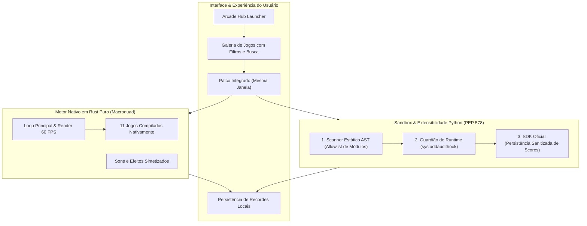

<div align="center">

# Arcade Hub

### Estação Desktop Offline & Launcher de Jogos Retrô em Alta Performance

[](https://www.rust-lang.org/)
[](https://www.python.org/)
[](https://macroquad.rs/)
[](#-motores-e-desempenho)
[-purple.svg?style=flat-square)](#)
[](LICENSE)

*Um launcher de jogos retrô e clássicos para desktop com inicialização instantânea (<50ms), renderização acelerada por hardware na mesma janela e sandbox de segurança com defesa em profundidade.*

[Jogos Inclusos](#-catálogo-de-jogos) • [Arquitetura](#-arquitetura--motores) • [Como Executar](#-como-executar) • [Segurança & Sandbox](#-arquitetura-de-segurança) • [Adicionar Jogos](#-como-adicionar-novos-jogos)

</div>

---

## 🕹️ Visão Geral

O **Arcade Hub** reúne o espírito das máquinas de fliperama e dos clássicos da computação em uma estação desktop moderna, minimalista e 100% offline. 

Diferente de launchers convencionais baseados em Electron ou wrappers de navegadores que pesam centenas de megabytes, o Arcade Hub adota uma engenharia orientada a performance extrema:

- **Binário Nativo Leve**: Executável único de apenas ~4.1 MB compilado em Rust.
- **Palco Integrado**: Todos os jogos rodam dentro da mesma janela da galeria, sem abrir pop-ups, terminais pretos ou múltiplas instâncias.
- **Latência Zero**: Física e renderização direta a 60+ FPS sincronizados com a taxa de atualização do monitor.
- **Segurança Rigorosa**: Ecossistema Python desacoplado com validação estática de código (AST) e ganchos de auditoria em runtime (PEP 578) para carregar jogos da comunidade com total proteção do sistema operacional.

---

## ⚡ Motores e Desempenho

O projeto foi construído sobre duas implementações complementares:

| Critério | Motor Nativo Rust (`arcade_hub_rust/`) | Hub Python Extensível (`app/`) | Soluções Web/Electron Convencionais |
| :--- | :--- | :--- | :--- |
| **Inicialização** | **< 50 ms (Instantânea)** | ~1.2 s | 4 a 8 s |
| **Consumo de Memória** | **~25 MB RAM** | ~60 MB RAM | 350 MB a 800 MB RAM |
| **Taxa de Quadros** | **60+ FPS fluidos (V-Sync)** | 30–60 FPS (Canvas) | Variável (com stuttering) |
| **Uso de Portas / Rede** | **Zero portas abertas** | Localhost interno | Portas locais abertas + telemetria |
| **Executável Único** | Sim (`ArcadeHub.exe`) | Requer runtime Python | Pacotes > 150 MB |
| **Extensibilidade** | Código Rust de alta eficiência | Estúdio dinâmico com sandbox | Plugins Web |

---

## 🎮 Catálogo de Jogos

O hub já vem com **11 jogos clássicos integrados**, desenvolvidos com mecânicas completas, placares locais e artes temáticas:

| Jogo | Categoria | Mecânica Principal | Controles Recomendados |
| :--- | :--- | :--- | :--- |
| **Space Odyssey** | Ação Espacial | Propulsão a jato vetorial, disparos laser duplos, chuva de asteroides e detecção contínua de colisões | `Setas` / `WASD` + `Espaço` |
| **Snake Arcade** | Arcade Retrô | Serpente de coordenadas discretas, maçãs com aumento dinâmico de velocidade e placar em tempo real | `Setas direcionais` |
| **Pong Arcade** | Esporte Clássico | Duelo solo contra inteligência artificial adaptativa com física de rebote por ponto de impacto na raquete | `W` / `S` ou `Setas Cima/Baixo` |
| **Breakout Prism** | Destruição / Reflexos | Demolição de grades de tijolos prismáticos multicoloridos com aceleração de ricochete | `Setas Esquerda/Direita` |
| **Flappy Jetpack** | Habilidade / Timing | Impulso gravitacional rítmico entre colunas de obstáculos com progressão infinita | `Espaço` ou `Clique esquerdo` |
| **Tron Lightcycles** | Duelo Tático | Disputa de reflexos em arena fechada neon contra IA competitiva evitando cruzamento de trilhas de luz | `Setas direcionais` |
| **Cannon Ballistics** | Estratégia / Física | Ajuste balístico de ângulo e vetor de propulsão parabólica contra alvos em movimento | `Setas` + `Enter` |
| **Memory Tiles** | Lógica / Quebra-Cabeça | Quebra-cabeça clássico de 15 peças deslizantes com gerador de embaralhamento 100% solucionável | `Clique no bloco` |
| **Minesweeper Grid** | Tabuleiro de Raciocínio | Campo minado clássico 10x10 com primeiro clique sempre seguro, expansão em cascata e marcadores | `Clique esq.` (revelar) / `dir.` (bandeira) |
| **Four in a Row** | Estratégia de Tabuleiro | Jogo de conexão vertical de 4 fichas alinhadas em grade 7x6 contra IA tática | `Colunas 1 a 7` / `Clique` |
| **Pac-Man Classic** | Arcade de Labirinto | Navegação em labirinto retrô com coleta de pastilhas, inteligência de patrulha e dispersão de fantasmas | `Setas direcionais` |

---

## 📐 Arquitetura & Motores



---

## 🔒 Arquitetura de Segurança

Para permitir a adição de jogos criados pela comunidade sem colocar em risco o sistema do usuário, o Arcade Hub implementa uma **Defesa em Profundidade em 3 Camadas**:

```
[Código do Jogo .py]
         │
         ▼
┌────────────────────────────────────────────────────────┐
│  Camada 1: Scanner Estático AST (ast_validator.py)     │
│  - Bloqueia chamadas a os, sys, subprocess, socket     │
│  - Impede exec(), eval(), __import__ e reflexão        │
└────────────────────────────────────────────────────────┘
         │ (Aprovado na análise)
         ▼
┌────────────────────────────────────────────────────────┐
│  Camada 2: Guardião de Runtime (security_runner.py)    │
│  - Python Audit Hooks (PEP 578: sys.addaudithook)      │
│  - Namespace isolado em safe_builtins                  │
│  - Bloqueio de rede, portas de socket e abertura de DLLs│
└────────────────────────────────────────────────────────┘
         │ (Em execução)
         ▼
┌────────────────────────────────────────────────────────┐
│  Camada 3: SDK Oficial Controlado (hub_sdk.py)         │
│  - API restrita para salvar High Scores (JSON <= 64KB) │
│  - Sem permissão de escrita arbitrária em disco        │
└────────────────────────────────────────────────────────┘
```

---

## 🚀 Como Executar

### 1. Executável Pré-compilado (Recomendado para Usuários)
Você não precisa compilar nada se não quiser. Basta executar o binário direto na raiz do projeto:

```powershell
.\ArcadeHub.exe
```

---

### 2. Compilação a partir do Código-Fonte em Rust
Requisitos: [Rust & Cargo](https://rustup.rs/) instalados.

```bash
# Entre no diretório do motor Rust
cd arcade_hub_rust

# Execute em modo de desenvolvimento
cargo run

# Ou compile a versão final de alto desempenho
cargo build --release
```
O executável otimizado estará disponível em `arcade_hub_rust/target/release/ArcadeHub.exe`.

---

### 3. Execução do Hub Desktop em Python
Requisitos: Python 3.10+ e bibliotecas gráficas padrão.

```bash
# Execução direta com o inicializador desktop
python app/main_desktop.py
```

Ou execute via navegador através do servidor local seguro:
```bash
python app/server.py
# Acesse: http://localhost:8090
```

---

## 🧩 Como Adicionar Novos Jogos

O hub suporta a inclusão dinâmica de novos títulos em sua galeria Python:

1. Crie uma pasta dentro de `games/<id_do_jogo>/`.
2. Adicione um manifesto `manifest.json`:
```json
{
  "id": "meu_jogo",
  "title": "Meu Jogo Incrível",
  "category": "Arcade",
  "author": "Seu Nome",
  "description": "Desvie dos obstáculos e alcance o recorde máximo.",
  "version": "1.0.0",
  "entrypoint": "main.py"
}
```
3. Implemente a classe padrão em `main.py`:
```python
from app.hub_sdk import ArcadeSDK

class Game:
    def __init__(self, canvas_width=800, canvas_height=600):
        self.width = canvas_width
        self.height = canvas_height
        self.score = 0
        self.sdk = ArcadeSDK("meu_jogo")

    def update(self, dt, inputs):
        # inputs contém teclas pressionadas e estado do mouse
        if inputs.get("space"):
            self.score += 10

    def render(self, ctx):
        # Renderize formas, texto ou sprites no contexto gráfico
        ctx.fill_style("#0A1128")
        ctx.fill_rect(0, 0, self.width, self.height)
```
4. Ao abrir o Arcade Hub, o jogo será validado automaticamente pelo scanner AST e exibido na galeria!

---

## 📁 Estrutura de Diretórios

```
arcade-hub/
├── arcade_hub_rust/             # Motor Nativo Rust de 60 FPS
│   ├── Cargo.toml               # Dependências (macroquad, serde, etc.)
│   ├── assets/                  # Tipografias vetoriais embutidas
│   ├── src/
│   │   ├── main.rs              # Loop principal e roteamento do app
│   │   ├── theme.rs             # Paleta de cores e design tokens
│   │   ├── models.rs            # Estruturas de dados e estados
│   │   ├── ui/                  # Componentes de interface (Header, Hero, Galeria, Palco)
│   │   └── games/               # 11 jogos implementados em Rust puro
│   └── scores.json              # Registro local de recordes
├── app/                         # Hub Desktop e Servidor Python
│   ├── main_desktop.py          # Ponto de entrada nativo sem terminal
│   ├── game_engine.py           # Renderizador gráfico in-window
│   ├── ast_validator.py         # Scanner estático de segurança
│   ├── security_runner.py       # Sandbox em runtime com audit hooks
│   ├── hub_sdk.py               # SDK oficial de pontuação
│   ├── server.py                # Servidor local de ativos
│   └── index.html               # Interface moderna de usuário
├── games/                       # Catálogo modular de jogos Python
├── data/                        # Dados locais de configuração
├── ArcadeHub.exe                # Executável compilado pronto para uso
├── PROJECT_CHECKLIST.md         # Acompanhamento técnico do projeto
├── SECURITY_ARCHITECTURE.md     # Especificação técnica da sandbox
├── SECTIONS.md                  # Especificação visual da interface
├── LICENSE                      # Licença MIT
└── README.md                    # Documentação principal do projeto
```

---

## ⌨️ Atalhos Rápidos

| Atalho | Ação |
| :--- | :--- |
| `Ctrl + K` | Abrir busca rápida universal de jogos |
| `Esc` | Pausar jogo ou retornar para a galeria |
| `Espaço` / `Enter` | Confirmar seleção ou ação de jogo |
| `F11` | Alternar modo tela cheia |

---

## 🎖️ Créditos e Reconhecimentos

- **Grant Jenks** (*Free Python Games*) — Inspiração de lógica algorítmica para jogos clássicos 2D.
- **Al Sweigart** (*Invent with Python*) — Referências didáticas de quebra-cabeças e física retrô.
- **Equipe Macroquad** — Motor gráfico 2D minimalista em Rust para desenvolvimento ágil de jogos nativos.

---

## 📄 Licença

Este projeto é disponibilizado sob a licença [MIT](LICENSE). Sinta-se livre para jogar, modificar, clonar e criar seus próprios jogos comunitários!
